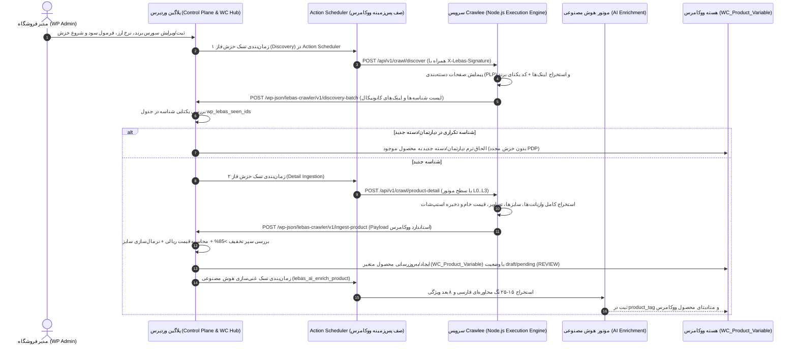

# مشخصات فنی و معماری جامع پلاگین وردپرس/ووکامرس و سرویس خزشگر Crawlee
# (`spec-scrapper-crawlee-world-plugin.md`)

**نسخه سند:** `1.0.0-WP-WC-CRAWLEE`  
**هدف سند:** مرجع کامل مهندسی و دستورالعمل اجرایی (Blueprint) برای ساخت **پلاگین اختصاصی وردپرس/ووکامرس (`lebas-crawlee-connector`)** و **میکروسرویس خزشگر (`lebas-crawlee-engine`)** مبتنی بر **Crawlee** و **API-First Architecture** جهت تحویل مستقیم به **Claude Code**.  
**استانداردهای پایه:** WordPress Plugin API, WordPress REST API (`WP_REST_Controller`), WooCommerce CRUD Objects (`WC_Product_Variable`, `WC_Product_Variation`), WooCommerce Action Scheduler, WooCommerce HPOS, Crawlee (`PlaywrightCrawler`, `CheerioCrawler`, `HttpCrawler`).

---

## فهرست مطالب (Table of Contents)

1. [نمای کلی معماری و تقسیم وظایف (Architecture & Responsibility Split)](#1-architecture)
2. [ساختار دایرکتوری و فایل‌های پروژه (Repository & Directory Structure)](#2-directory-structure)
3. [طراحی جداول اختصاصی دیتابیس وردپرس با `dbDelta` (Custom DB Schema)](#3-database-schema)
4. [نگاشت موجودیت‌ها به استاندارد ووکامرس (WooCommerce Data Mapping & Taxonomies)](#4-woocommerce-mapping)
5. [قراردادهای کامل ارتباطی API بین وردپرس و Crawlee (REST API Contracts & Payloads)](#5-api-contracts)
6. [معماری درونی سرویس Node.js Crawlee و ناوگان L0–L3 (Crawlee Service Specification)](#6-crawlee-service)
7. [معماری درونی پلاگین وردپرس و صف‌های Action Scheduler (WordPress Plugin Internals)](#7-wp-plugin-internals)
8. [موتور قیمت‌گذاری، تبدیل ارز و سپر ایمنی تخفیف ۸۵٪ در ووکامرس (Pricing & FX Engine)](#8-pricing-engine)
9. [صف استعلام زنده موجودی در ووکامرس (On-Demand Flash Sales & Live Validation)](#9-flash-sales)
10. [پایپ‌لاین هوش مصنوعی و تگ‌گذاری ۸ بعدی در ووکامرس (AI Enrichment & Tagging)](#10-ai-pipeline)
11. [استودیوی کالیبراسیون ۵ کالایی و پنل مدیریت در پیشخوان وردپرس (WP Admin UI)](#11-admin-ui)
12. [مشخصات رفتاری کامل با فرمت BDD (Gherkin BDD Scenarios)](#12-bdd-specs)
13. [یکپارچه‌سازی عمیق با Elementor Pro (Dynamic Tags, Loop Grid & WooCommerce Builder)](#13-elementor-pro)
14. [دستورالعمل گام‌به‌گام پیاده‌سازی برای Claude Code (Implementation Prompt & Checklist)](#14-claude-code-instructions)

---

<a id="1-architecture"></a>
## ۱. نمای کلی معماری و تقسیم وظایف (Architecture & Responsibility Split)

تمامی ارتباطات بین وردپرس/ووکامرس و موتور خزشگر **Crawlee** به صورت **۱۰۰٪ API-Based** و مبتنی بر قراردادهای JSON استاندارد و امضای امنیتی HMAC-SHA256 انجام می‌شود.



### ۱.۱. وظایف پلاگین وردپرس (`lebas-crawlee-connector`)
1. **مدیریت مرکزی (Control Plane):** نگهداری لیست سورس‌ها، برندها، آدرس‌های کاتالوگ، نرخ لحظه‌ای ارز (TRY/EUR/USD به ریال)، فرمول‌های سود و باربری، و وضعیت نردبان ضد بات (L0 تا L3).
2. **مدیریت صف‌های ناهمگام با Action Scheduler:** استفاده از موتور داخلی و استاندارد ووکامرس (`ActionScheduler` / `as_enqueue_async_action` و `as_schedule_recurring_action`) برای ارسال درخواست‌ها به Crawlee، پردازش Webhookها، دانلود تصاویر به کتابخانه رسانه وردپرس (`media_handle_sideload`) و غنی‌سازی هوش مصنوعی بدون ایجاد Timeout در PHP.
3. **مهار تکرار و انتساب چندگانه (Deduplication & Multi-Department):** بررسی کد یکتای مادر برند (`brand_master_sku`) قبل از خزش صفحه محصول؛ اگر محصول قبلاً اسکرپ شده باشد، فقط دپارتمان جدید (`pa_department` یا `product_cat`) به محصول ووکامرس اضافه می‌شود.
4. **مدیریت کاتالوگ از طریق کلاس‌های CRUD رسمی ووکامرس:** استفاده انحصاری از `WC_Product_Variable`، `WC_Product_Variation`، `wc_get_product()` و توابع رسمی ووکامرس (عدم دستکاری مستقیم و غیراستاندارد جدول `wp_posts`).
5. **قانون عدم انتشار خودکار (Zero Auto-Publishing):** تمام محصولات جدید اسکرپ‌شده با وضعیت `pending` (در انتظار بررسی / `REVIEW`) در ووکامرس ثبت می‌شوند و تنها پس از تایید ادمین به `publish` تغییر می‌یابند.
6. **استودیوی کالیبراسیون ۵ کالایی:** متوقف کردن خزش انبوه برند جدید پس از دریافت ۵ کالای اول تا زمان تایید صحت سایز، قیمت و تگ‌ها توسط ادمین در پیشخوان وردپرس.

### ۱.۲. وظایف سرویس Crawlee (`lebas-crawlee-engine`)
1. **اجرای خزش دو مرحله‌ای (Two-Phase Crawling):**
   - **فاز ۱ (`/api/v1/crawl/discover`):** پیمایش صفحات لیستینگ (PLP) و استخراج آدرس‌های کانونیکال و شناسه مادر برند (`brand_master_sku`).
   - **فاز ۲ (`/api/v1/crawl/product-detail`):** خزش عمیق صفحه تک‌محصول (PDP)، استخراج عنوان، کد مدل، رنگ، جدول سایزها، موجودی هر سایز، قیمت اصلی و قیمت فعلی در ارز مبدا، و لینک تصاویر باکیفیت.
   - **فاز استعلام آنی (`/api/v1/crawl/live-check`):** بررسی فوق‌سریع قیمت و موجودی سایزهای یک محصول در کمتر از ۳ ثانیه برای صف فلش‌سیلز و اعتبارسنجی سبد خرید.
2. **مدیریت ناوگان ۴ سطحی ضد بات (L0–L3 Escalation):**
   - **L0:** `HttpCrawler` / JSON API مستقیم با مصرف حداقل منابع.
   - **L1:** جعل فینگرپرینت TLS/JA3 و هدرهای مرورگر (`got-scraping` در Crawlee).
   - **L2:** `PlaywrightCrawler` با مرورگر هدلس کرومیوم و پلاگین‌های Stealth و چرخش Fingerprint/Proxy.
   - **L3:** مرورگر هدلس به همراه حل‌کننده هوشمند چالش‌های امنیتی (Cloudflare/PerimeterX/DataDome).
3. **ارسال خروجی استاندارد به Webhook وردپرس:** بسته‌بندی داده‌های استخراج‌شده در قالب JSON استاندارد ووکامرس و ارسال به اندپوینت REST پلاگین وردپرس.

---

<a id="2-directory-structure"></a>
## ۲. ساختار دایرکتوری و فایل‌های پروژه (Repository & Directory Structure)

Claude Code باید پروژه را در دو بخش کاملاً ماژولار و استاندارد ایجاد کند:

### ۲.۱. ساختار پلاگین وردپرس (`wp-content/plugins/lebas-crawlee-connector/`)

```text
lebas-crawlee-connector/
├── lebas-crawlee-connector.php          # فایل اصلی پلاگین، تعریف ثابت‌ها، هوک‌های فعال‌سازی و بارگذاری Autoloader
├── composer.json                        # مدیریت وابستگی‌های PHP و PSR-4 Autoloading (Namespace: Lebas\Crawler\)
├── uninstall.php                        # پاکسازی ایمن تنظیمات در صورت حذف کامل پلاگین
├── assets/
│   ├── css/
│   │   ├── admin-dashboard.css          # استایل‌های پنل مدیریت اسکرپر و استودیو کالیبراسیون در پیشخوان وردپرس
│   │   └── frontend-live-check.css      # استایل‌های وضعیت اعتبارسنجی زنده در صفحه محصول ووکامرس
│   └── js/
│       ├── admin-calibration.js         # اسکریپت‌های تعاملی استودیو کالیبراسیون ۵ کالایی و مدیریت سورس‌ها
│       └── frontend-stock-poller.js     # اسکریپت Polling سبک وضعیت موجودی سایزها در PDP ووکامرس
├── includes/
│   ├── Core/
│   │   ├── Plugin.php                   # کلاس Bootstrap مرکزی پلاگین و ثبت سرویس‌ها
│   │   ├── Installer.php                # ساخت و ارتقای جداول اختصاصی wp_lebas_* با dbDelta
│   │   ├── TaxonomyRegistrar.php        # ثبت ویژگی‌های ووکامرس (pa_brand, pa_department, pa_size, pa_color)
│   │   └── Security.php                 # امضا و اعتبارسنجی HMAC-SHA256، توکن‌های API و محافظت SSRF
│   ├── Api/
│   │   ├── RestRouter.php               # ثبت مسیرهای /wp-json/lebas-crawler/v1/*
│   │   ├── DiscoveryWebhookController.php # دریافت لیست لینک‌های فاز ۱ از Crawlee و فیلتر شناسه‌های تکراری
│   │   ├── ProductIngestController.php  # دریافت محصول کامل از Crawlee و زمان‌بندی ثبت در ووکامرس
│   │   ├── LiveStockController.php      # اندپوینت استعلام زنده موجودی برای فرانت‌اند ووکامرس
│   │   └── AdminApiController.php       # اندپوینت‌های AJAX/REST پنل ادمین وردپرس
│   ├── Client/
│   │   └── CrawleeApiClient.php         # کلاینت HTTP مبتنی بر wp_remote_post برای ارسال دستورات به سرویس Crawlee
│   ├── Catalog/
│   │   ├── BrandIdentifierRegistry.php  # الگوهای Regex استخراج کد مادر برند (Nike, Adidas, Zara, Massimo Dutti, Puma)
│   │   ├── UrlCanonicalizer.php         # پاکسازی پارامترهای رهگیری و نرمال‌سازی URLها
│   │   ├── WooProductSyncService.php    # ساخت و آپدیت WC_Product_Variable و WC_Product_Variation طبق استاندارد ووکامرس
│   │   ├── MediaSideloaderService.php   # دانلود ناهمگام تصاویر محصول، تبدیل به WebP و اتصال به گالری محصول ووکامرس
│   │   ├── SizeNormalizer.php           # نرمال‌سازی سایزهای مبدا به EU و سانتی‌متر
│   │   └── ColorNormalizer.php          # نرمال‌سازی نام رنگ‌ها به فارسی لوکس
│   ├── Pricing/
│   │   ├── PricingEngine.php            # فرمول تبدیل ارز، باربری هوایی بر اساس وزن، مارک‌آپ و رند کردن به میلیون ریال
│   │   ├── FxRateManager.php            # مدیریت نرخ ارز، بافر ریسک نوسان و تاریخچه نرخ‌ها
│   │   └── DiscountSafeguard.php        # سپر ایمنی تخفیف بالای ۸۵٪ (ADR-0001) و قرنطینه خودکار
│   ├── Queue/
│   │   ├── ActionSchedulerDispatcher.php # ثبت و مدیریت صف‌های ناهمگام در Action Scheduler ووکامرس
│   │   ├── CrawlJobWorker.php           # ورکر اجرای خزش دوره‌ای و ارسال درخواست به Crawlee
│   │   ├── FlashSaleWorker.php          # ورکر استعلام دو مرحله‌ای (دقیقه ۰ و دقیقه ۵) برای کالاهای تخفیف‌دار
│   │   └── AiEnrichmentWorker.php       # ورکر ارسال محصول به سرویس هوش مصنوعی و ثبت ۱۵-۲۵ تگ در ووکامرس
│   └── Admin/
│       ├── AdminMenu.php                # ثبت منوهای پیشخوان وردپرس زیرمجموعه ووکامرس
│       ├── SourcesPage.php              # صفحه مدیریت سورس‌ها، برندها و نردبان L0-L3
│       ├── CalibrationStudioPage.php    # استودیو کالیبراسیون ۵ کالایی قبل از خزش انبوه
│       ├── QuarantinePage.php           # صفحه بررسی محصولات قرنطینه‌شده (تخفیف >85% یا ناهنجاری قیمت)
│       └── LogsAndHealthPage.php        # داشبورد مانیتورینگ ۴۸ موتور، لاگ‌های خطا و وضعیت Circuit Breaker
└── tests/
    ├── Unit/
    │   ├── BrandIdentifierTest.php
    │   ├── PricingEngineTest.php
    │   └── DiscountSafeguardTest.php
    └── Integration/
        └── WooProductSyncTest.php
```

### ۲.۲. ساختار سرویس Node.js Crawlee (`crawlee-service/`)

```text
crawlee-service/
├── package.json                         # وابستگی‌ها: crawlee, playwright, fastify (یا express), zod, pino
├── tsconfig.json
├── Dockerfile                           # ایمیج رسمی Playwright/Crawlee آماده اجرا روی Docker
├── docker-compose.yml
└── src/
    ├── server.ts                        # سرور REST API با Fastify و احراز هویت HMAC
    ├── config/
    │   └── env.ts                       # تنظیمات پورت، کلید مشترک وردپرس، پروکسی‌ها و محدودیت همزمانی
    ├── routes/
    │   ├── discover.route.ts            # POST /api/v1/crawl/discover (فاز ۱: استخراج لینک‌ها از PLP)
    │   ├── detail.route.ts              # POST /api/v1/crawl/product-detail (فاز ۲: استخراج کامل PDP)
    │   ├── live-check.route.ts          # POST /api/v1/crawl/live-check (استعلام فوری موجودی و قیمت)
    │   └── health.route.ts              # GET /api/v1/health (وضعیت ناوگان و موتورهای L0-L3)
    ├── fleet/
    │   ├── EscalationManager.ts         # مدیریت نردبان ارتقای خودکار L0 -> L1 -> L2 -> L3
    │   ├── L0HttpRunner.ts              # اجرای سریع مبتنی بر JSON/HTTP
    │   ├── L1TlsRunner.ts               # اجرای مبتنی بر CheerioCrawler + got-scraping (TLS/JA3)
    │   ├── L2PlaywrightRunner.ts        # اجرای مبتنی بر PlaywrightCrawler با Fingerprints و Stealth
    │   └── L3CognitiveSolverRunner.ts   # اجرای همراه با حل چالش‌های ضد بات پیشرفته
    ├── adapters/
    │   ├── BaseBrandAdapter.ts          # کلاس پایه تمام آداپتورهای برند
    │   ├── NikeAdapter.ts               # آداپتور اختصاصی نایک
    │   ├── AdidasAdapter.ts             # آداپتور اختصاصی آدیداس
    │   ├── ZaraAdapter.ts               # آداپتور اختصاصی زارا / ایندیتکس
    │   ├── MassimoDuttiAdapter.ts       # آداپتور اختصاصی ماسیمو دوتی
    │   ├── PumaAdapter.ts               # آداپتور اختصاصی پوما
    │   └── UniversalSchemaAdapter.ts    # آداپتور عمومی مبتنی بر JSON-LD (Schema.org/Product) و OpenGraph
    ├── normalizers/
    │   ├── IdentifierExtractor.ts       # استخراج کد یکتای مادر برند از URL و DOM
    │   └── WooPayloadBuilder.ts         # ساخت خروجی استاندارد منطبق با اسکیمای ورودی پلاگین ووکامرس
    └── webhook/
        └── WordPressWebhookSender.ts    # ارسال امن نتایج با امضای HMAC و Retry با Exponential Backoff به وردپرس
```

---

<a id="3-database-schema"></a>
## ۳. طراحی جداول اختصاصی دیتابیس وردپرس با `dbDelta` (Custom DB Schema)

برای جلوگیری از کند شدن جدول `wp_postmeta` در ووکامرس، کلاس `Installer.php` در زمان فعال‌سازی پلاگین (`register_activation_hook`) جداول زیر را با تابع استاندارد `dbDelta()` وردپرس ایجاد می‌کند:

### ۳.۱. جدول منابع و برندها (`{prefix}lebas_sources`)
```sql
CREATE TABLE {prefix}lebas_sources (
    id BIGINT UNSIGNED NOT NULL AUTO_INCREMENT,
    brand_slug VARCHAR(100) NOT NULL,
    brand_name_fa VARCHAR(150) NOT NULL,
    brand_name_en VARCHAR(150) NOT NULL,
    base_url VARCHAR(255) NOT NULL,
    source_currency CHAR(3) NOT NULL DEFAULT 'TRY',
    catalog_urls_json LONGTEXT NOT NULL, -- آرایه JSON از لینک‌های کاتالوگ به تفکیک دپارتمان (women, men, kids) و دسته
    current_escalation_level TINYINT UNSIGNED NOT NULL DEFAULT 0, -- 0=L0, 1=L1, 2=L2, 3=L3
    calibration_status VARCHAR(30) NOT NULL DEFAULT 'PENDING_CALIBRATION', -- PENDING_CALIBRATION, IN_REVIEW, CALIBRATED
    calibrated_samples_count INT UNSIGNED NOT NULL DEFAULT 0,
    margin_mode VARCHAR(20) NOT NULL DEFAULT 'GLOBAL', -- GLOBAL, CUSTOM
    custom_margin_pct DECIMAL(5,2) DEFAULT NULL,
    flash_sale_trigger_discount_pct INT UNSIGNED NOT NULL DEFAULT 40,
    circuit_state VARCHAR(20) NOT NULL DEFAULT 'CLOSED', -- CLOSED, OPEN, HALF_OPEN
    consecutive_failures INT UNSIGNED NOT NULL DEFAULT 0,
    circuit_opened_until DATETIME DEFAULT NULL,
    is_active TINYINT(1) NOT NULL DEFAULT 1,
    last_crawled_at DATETIME DEFAULT NULL,
    created_at DATETIME NOT NULL DEFAULT CURRENT_TIMESTAMP,
    updated_at DATETIME NOT NULL DEFAULT CURRENT_TIMESTAMP ON UPDATE CURRENT_TIMESTAMP,
    PRIMARY KEY  (id),
    UNIQUE KEY idx_brand_slug (brand_slug),
    KEY idx_active_calibration (is_active, calibration_status)
) ENGINE=InnoDB DEFAULT CHARSET=utf8mb4 COLLATE=utf8mb4_unicode_ci;
```

### ۳.۲. جدول رجیستری شناسه‌های یکتای برند و نگاشت به محصول ووکامرس (`{prefix}lebas_seen_identifiers`)
```sql
CREATE TABLE {prefix}lebas_seen_identifiers (
    id BIGINT UNSIGNED NOT NULL AUTO_INCREMENT,
    brand_slug VARCHAR(100) NOT NULL,
    brand_master_sku VARCHAR(120) NOT NULL, -- مثلاً HJ2146-600 در نایک یا KK4860 در آدیداس
    canonical_source_url VARCHAR(500) NOT NULL,
    wc_product_id BIGINT UNSIGNED DEFAULT NULL, -- شناسه محصول در wp_posts (WC_Product_Variable)
    departments_json VARCHAR(255) NOT NULL DEFAULT '[]', -- مثلاً ["women", "men"]
    categories_json VARCHAR(255) NOT NULL DEFAULT '[]', -- مثلاً ["shoes", "new-arrivals"]
    ingest_state VARCHAR(30) NOT NULL DEFAULT 'DISCOVERED', -- DISCOVERED, QUEUED, INGESTED, QUARANTINED, FAILED
    last_seen_at DATETIME NOT NULL DEFAULT CURRENT_TIMESTAMP,
    last_detail_scraped_at DATETIME DEFAULT NULL,
    created_at DATETIME NOT NULL DEFAULT CURRENT_TIMESTAMP,
    PRIMARY KEY  (id),
    UNIQUE KEY idx_brand_master_sku (brand_slug, brand_master_sku),
    KEY idx_wc_product_id (wc_product_id),
    KEY idx_ingest_state (ingest_state)
) ENGINE=InnoDB DEFAULT CHARSET=utf8mb4 COLLATE=utf8mb4_unicode_ci;
```

### ۳.۳. جدول پیشنهادهای منشا و موجودی سایزها (`{prefix}lebas_source_offers`)
```sql
CREATE TABLE {prefix}lebas_source_offers (
    id BIGINT UNSIGNED NOT NULL AUTO_INCREMENT,
    wc_product_id BIGINT UNSIGNED NOT NULL,
    wc_variation_id BIGINT UNSIGNED NOT NULL,
    source_id BIGINT UNSIGNED NOT NULL,
    brand_master_sku VARCHAR(120) NOT NULL,
    external_variant_id VARCHAR(150) NOT NULL,
    original_size VARCHAR(60) NOT NULL,
    normalized_size VARCHAR(60) NOT NULL,
    source_currency CHAR(3) NOT NULL DEFAULT 'TRY',
    source_original_price_minor BIGINT UNSIGNED NOT NULL, -- قیمت اولیه به قروش/سنت (عدد صحیح)
    source_current_price_minor BIGINT UNSIGNED NOT NULL, -- قیمت فعلی در مبدا به قروش/سنت
    source_discount_pct INT UNSIGNED NOT NULL DEFAULT 0,
    calculated_irt_price BIGINT UNSIGNED NOT NULL, -- قیمت نهایی محاسبه‌شده به ریال/تومان
    display_million_rial INT UNSIGNED NOT NULL, -- عدد گرد شده به بالا بر حسب میلیون ریال
    stock_state VARCHAR(25) NOT NULL DEFAULT 'UNKNOWN', -- IN_STOCK, LOW_STOCK, OUT_OF_STOCK, UNKNOWN
    parser_confidence DECIMAL(4,3) NOT NULL DEFAULT 1.000,
    adapter_version VARCHAR(30) NOT NULL DEFAULT '1.0.0',
    last_validated_at DATETIME NOT NULL DEFAULT CURRENT_TIMESTAMP,
    PRIMARY KEY  (id),
    UNIQUE KEY idx_variation_source (wc_variation_id, source_id),
    KEY idx_product_stock (wc_product_id, stock_state),
    KEY idx_discount_pct (source_discount_pct)
) ENGINE=InnoDB DEFAULT CHARSET=utf8mb4 COLLATE=utf8mb4_unicode_ci;
```

### ۳.۴. جدول اسنپ‌شات‌های خام (`{prefix}lebas_raw_snapshots`)
```sql
CREATE TABLE {prefix}lebas_raw_snapshots (
    id BIGINT UNSIGNED NOT NULL AUTO_INCREMENT,
    source_id BIGINT UNSIGNED NOT NULL,
    brand_master_sku VARCHAR(120) NOT NULL,
    payload_checksum CHAR(64) NOT NULL, -- SHA-256
    raw_payload_compressed LONGBLOB NOT NULL, -- فشرده‌سازی شده با gzcompress برای بهینه‌سازی فضا
    parser_version VARCHAR(30) NOT NULL,
    escalation_level TINYINT UNSIGNED NOT NULL DEFAULT 0,
    captured_at DATETIME NOT NULL DEFAULT CURRENT_TIMESTAMP,
    PRIMARY KEY  (id),
    KEY idx_sku_captured (brand_master_sku, captured_at),
    KEY idx_checksum (payload_checksum)
) ENGINE=InnoDB DEFAULT CHARSET=utf8mb4 COLLATE=utf8mb4_unicode_ci;
```

### ۳.۵. جدول لاگ‌های اجرا و خطاهای اسکرپر (`{prefix}lebas_scraper_logs`)
```sql
CREATE TABLE {prefix}lebas_scraper_logs (
    id BIGINT UNSIGNED NOT NULL AUTO_INCREMENT,
    job_id VARCHAR(64) NOT NULL,
    source_id BIGINT UNSIGNED NOT NULL,
    target_url VARCHAR(500) NOT NULL,
    phase VARCHAR(20) NOT NULL, -- DISCOVERY, DETAIL, LIVE_CHECK
    result_state VARCHAR(30) NOT NULL, -- SUCCESS, PARTIAL, BLOCKED, CHANGED, NOT_FOUND, RATE_LIMITED, PARSER_ERROR
    escalation_level TINYINT UNSIGNED NOT NULL DEFAULT 0,
    duration_ms INT UNSIGNED NOT NULL DEFAULT 0,
    http_status INT UNSIGNED DEFAULT NULL,
    error_message TEXT DEFAULT NULL,
    created_at DATETIME NOT NULL DEFAULT CURRENT_TIMESTAMP,
    PRIMARY KEY  (id),
    KEY idx_source_state (source_id, result_state, created_at),
    KEY idx_job_id (job_id)
) ENGINE=InnoDB DEFAULT CHARSET=utf8mb4 COLLATE=utf8mb4_unicode_ci;
```

---

<a id="4-woocommerce-mapping"></a>
## ۴. نگاشت موجودیت‌ها به استاندارد ووکامرس (WooCommerce Data Mapping & Taxonomies)

برای اینکه **Elementor Pro**، حلقه‌های محصول (Loop Grid)، فیلترهای ووکامرس و سبد خرید به صورت ۱۰۰٪ بومی (Native) با محصولات کار کنند، تمام محصولات اسکرپ‌شده باید دقیقاً طبق ساختار زیر در ووکامرس ذخیره شوند:

| مفهوم در SPEC لـبـاس | معادل استاندارد در ووکامرس (`WC_Product`) | جزئیات پیاده‌سازی در پلاگین |
| :--- | :--- | :--- |
| **Product (کالای اصلی)** | `WC_Product_Variable` (`post_type = 'product'`) | هر کالا با رنگ مشخص یک محصول متغیر ووکامرس است. |
| **Product Lifecycle (`REVIEW`)** | `post_status = 'pending'` | هیچ کالای جدیدی با وضعیت `publish` ثبت نمی‌شود؛ همگی در وضعیت `pending` (در انتظار بررسی) وارد می‌شوند. |
| **Quarantined Product** | `post_status = 'draft'` + متای `_lebas_quarantine_reason` | اگر تخفیف >85% یا خطای قیمت رخ دهد، محصول به `draft` منتقل و در تب قرنطینه لیست می‌شود. |
| **Brand Master SKU** | `_sku` محصول مادر + متای `_lebas_brand_master_sku` | کد رسمی برند (مثل `HJ2146-600`). |
| **Variant (سایز قابل انتخاب)** | `WC_Product_Variation` (`post_type = 'product_variation'`) | هر سایز یک Variation استاندارد ووکامرس زیرمجموعه محصول مادر است. |
| **Canonical Departments** | ویژگی سراسری `pa_department` و دسته‌بندی سطح اول `product_cat` | شامل دقیقاً ۳ مقدار: `women` (بانوان)، `kids` (کودکان)، `men` (آقایان). یک محصول یونیسکس هر دو ترم `women` و `men` را می‌گیرد. |
| **Canonical Categories** | دسته‌بندی ووکامرس (`product_cat`) | شامل: `clothing` (پوشاک)، `shoes` (کفش)، `accessories` (اکسسوری)، و تگ/دسته `new-arrivals` (جدیدترین‌ها). |
| **Brand (برند)** | ویژگی سراسری `pa_brand` (و تاکسونومی `product_brand`) | نام برند به انگلیسی/فارسی با اسلاگ استاندارد (مثلاً `nike`, `adidas`, `zara`). |
| **Normalized Size** | ویژگی سراسری `pa_size` (Global Attribute با `variation = true`) | سایز نرمال‌شده (مثلاً `EU 42` یا `M`)؛ سایز اصلی مبدا در متای `_lebas_original_size` واریانت ذخیره می‌شود. |
| **Normalized Color** | ویژگی سراسری `pa_color` | رنگ نرمال‌شده به فارسی (مثلاً `مشکی`، `سفید صدفی`، `سبز زیتونی`). |
| **AI Colloquial Tags (۱۵-۲۵ تگ)** | برچسب‌های محصول ووکامرس (`product_tag`) | تمام ۱۵ تا ۲۵ تگ محاوره‌ای فارسی مستقیماً در `product_tag` ووکامرس ثبت می‌شوند تا در جستجو و صفحات تگ کار کنند. |
| **8D AI Enrichment Data** | متافیلد `_lebas_ai_enrichment_json` | شامل آبجکت JSON ابعاد ۸ گانه (فرم، جنس، موقعیت استفاده، فصل، قواره، نگهداری، ست‌پذیری). |
| **Regular Price (بدون حراجی)** | `_regular_price` و `_price` در ووکامرس | قیمت نهایی محاسبه‌شده (تک‌قیمتی، بدون پر کردن `_sale_price` برای جلوگیری از نمایش برچسب تخفیف بازاری در فرانت‌اند). |
| **Stock State** | `_stock_status` ووکامرس + متای `_lebas_stock_state` | در صورتی که `IN_STOCK` یا `LOW_STOCK` باشد، در ووکامرس `instock` و اگر `OUT_OF_STOCK` قطعی باشد `outofstock` ثبت می‌شود. اگر `UNKNOWN` باشد، وضعیت قبلی حفظ می‌گردد. |
| **Manual Override Locks** | متافیلد `_lebas_locked_fields` (آرایه JSON) | اگر ادمین در ویرایشگر ووکامرس عنوان، توضیحات یا قیمت محصولی را دستی تغییر دهد، نام آن فیلد در `_lebas_locked_fields` قفل می‌شود تا اسکرپر در دفعات بعدی آن را بازنویسی نکند. |

---

<a id="5-api-contracts"></a>
## ۵. قراردادهای کامل ارتباطی API بین وردپرس و Crawlee (REST API Contracts & Payloads)

### ۵.۱. احراز هویت دوطرفه (Mutual HMAC-SHA256 Authentication)
کلیه درخواست‌های HTTP بین پلاگین وردپرس و سرویس Crawlee باید دارای هدرهای امنیتی زیر باشند:
- `X-Lebas-Timestamp`: زمان یونیکس (ثانیه)؛ درخواست‌های با اختلاف بیش از ۳۰۰ ثانیه رد می‌شوند (جلوگیری از Replay Attack).
- `X-Lebas-Signature`: مقدار `hash_hmac('sha256', $timestamp . '.' . $raw_json_body, $shared_secret)`.
- `X-Lebas-Correlation-ID`: شناسه یکتای UUIDv4 برای ردیابی سرتاسری درخواست در لاگ‌ها.

---

### ۵.۲. اندپوینت‌های سرویس Crawlee (فراخوانی‌شده توسط پلاگین وردپرس)

#### الف) درخواست شروع خزش فاز ۱ — کشف لینک‌ها (`POST /api/v1/crawl/discover`)
**Request Payload (از وردپرس به Crawlee):**
```json
{
  "job_id": "job_disc_9f8a7b6c",
  "source_id": 12,
  "brand_slug": "nike",
  "escalation_level": 1,
  "max_items": 100,
  "targets": [
    {
      "catalog_url": "https://www.nike.com/tr/w/mens-shoes-nik1zy7ok",
      "department": "men",
      "category": "shoes",
      "is_new_arrival": false
    },
    {
      "catalog_url": "https://www.nike.com/tr/w/womens-shoes-5e1x6zy7ok",
      "department": "women",
      "category": "shoes",
      "is_new_arrival": true
    }
  ],
  "webhook_callback_url": "https://leb.as/wp-json/lebas-crawler/v1/discovery-batch"
}
```

#### ب) درخواست شروع خزش فاز ۲ — استخراج جزئیات محصول (`POST /api/v1/crawl/product-detail`)
**Request Payload (از وردپرس به Crawlee):**
```json
{
  "job_id": "job_det_3d2e1f0a",
  "source_id": 12,
  "brand_slug": "nike",
  "escalation_level": 2,
  "items": [
    {
      "brand_master_sku": "HJ2146-600",
      "canonical_url": "https://www.nike.com/tr/t/air-max-plus-ayakkab%C4%B1s%C4%B1-HJ2146-600",
      "departments": ["men", "women"],
      "categories": ["shoes", "new-arrivals"]
    }
  ],
  "webhook_callback_url": "https://leb.as/wp-json/lebas-crawler/v1/ingest-product"
}
```

#### ج) درخواست استعلام زنده موجودی و قیمت (`POST /api/v1/crawl/live-check`)
**Request Payload (از وردپرس به Crawlee):**
```json
{
  "job_id": "job_live_77c88d",
  "source_id": 12,
  "brand_slug": "nike",
  "brand_master_sku": "HJ2146-600",
  "canonical_url": "https://www.nike.com/tr/t/air-max-plus-ayakkab%C4%B1s%C4%B1-HJ2146-600",
  "escalation_level": 1,
  "timeout_ms": 4000
}
```
**Synchronous Response (پاسخ فوری از Crawlee به وردپرس):**
```json
{
  "status": "SUCCESS",
  "brand_master_sku": "HJ2146-600",
  "source_currency": "TRY",
  "source_original_price_minor": 699900,
  "source_current_price_minor": 489900,
  "variants": [
    {
      "external_variant_id": "HJ2146-600-40",
      "original_size": "EU 40",
      "stock_state": "IN_STOCK"
    },
    {
      "external_variant_id": "HJ2146-600-42",
      "original_size": "EU 42",
      "stock_state": "OUT_OF_STOCK"
    }
  ],
  "duration_ms": 1420
}
```

---

### ۵.۳. اندپوینت‌های Webhook پلاگین وردپرس (فراخوانی‌شده توسط سرویس Crawlee)

#### الف) دریافت نتایج فاز کشف (`POST /wp-json/lebas-crawler/v1/discovery-batch`)
**Request Payload (از Crawlee به وردپرس):**
```json
{
  "job_id": "job_disc_9f8a7b6c",
  "source_id": 12,
  "brand_slug": "nike",
  "result_state": "SUCCESS",
  "escalation_level_used": 1,
  "discovered_items": [
    {
      "brand_master_sku": "HJ2146-600",
      "canonical_url": "https://www.nike.com/tr/t/air-max-plus-ayakkab%C4%B1s%C4%B1-HJ2146-600",
      "department": "men",
      "category": "shoes",
      "is_new_arrival": true,
      "preview_title": "Nike Air Max Plus"
    }
  ]
}
```
**منطق پردازش در پلاگین وردپرس (`DiscoveryWebhookController.php`):**
1. برای هر آیتم، `BrandIdentifierRegistry` و `UrlCanonicalizer` صحت `brand_master_sku` را بررسی می‌کنند.
2. کوئری به جدول `{prefix}lebas_seen_identifiers` زده می‌شود:
   - **اگر شناسه قبلاً وجود داشت (`INGESTED`):** هیچ تسک خزش صفحه‌ای ساخته نمی‌شود! فقط `department` و `category` جدید به آرایه JSON اضافه شده و در صورت وجود `wc_product_id`، ترم جدید با `wp_set_object_terms()` به محصول ووکامرس الصاق می‌گردد.
   - **اگر شناسه جدید بود:** در جدول با وضعیت `DISCOVERED` درج می‌شود. اگر برند در حالت `PENDING_CALIBRATION` باشد و تعداد نمونه‌ها به ۵ عدد رسیده باشد، در صف کالیبراسیون می‌ماند؛ در غیر این صورت تسک `lebas_crawl_product_detail` در Action Scheduler ثبت می‌شود.

#### ب) دریافت اطلاعات کامل محصول و ثبت در ووکامرس (`POST /wp-json/lebas-crawler/v1/ingest-product`)
**Request Payload (از Crawlee به وردپرس — فرمت استاندارد آماده ووکامرس):**
```json
{
  "job_id": "job_det_3d2e1f0a",
  "source_id": 12,
  "brand_slug": "nike",
  "result_state": "SUCCESS",
  "parser_confidence": 0.98,
  "adapter_version": "1.2.0",
  "escalation_level_used": 2,
  "duration_ms": 2350,
  "raw_snapshot_base64_gz": "H4sIAAAAAAAAA...",
  "raw_snapshot_checksum": "e3b0c44298fc1c149afbf4c8996fb92427ae41e4649b934ca495991b7852b855",
  "product": {
    "brand_master_sku": "HJ2146-600",
    "canonical_url": "https://www.nike.com/tr/t/air-max-plus-ayakkab%C4%B1s%C4%B1-HJ2146-600",
    "raw_title": "Nike Air Max Plus Erkek Ayakkabısı",
    "raw_description": "Hava yastıklı, ikonik tasarım...",
    "departments": ["men", "women"],
    "categories": ["shoes", "new-arrivals"],
    "raw_color": "Black/University Red",
    "source_currency": "TRY",
    "source_original_price_minor": 699900,
    "source_current_price_minor": 559900,
    "estimated_weight_grams": 950,
    "images": [
      "https://static.nike.com/a/images/t_PDP_1728_v1/f_auto,q_auto:eco/air-max-plus-1.jpg",
      "https://static.nike.com/a/images/t_PDP_1728_v1/f_auto,q_auto:eco/air-max-plus-2.jpg"
    ],
    "specifications": {
      "upper_material": "Synthetic leather and airy mesh",
      "outsole": "Rubber",
      "country_of_origin": "Vietnam"
    },
    "variants": [
      {
        "external_variant_id": "HJ2146-600-40",
        "original_size": "EU 40",
        "size_system": "EU",
        "stock_state": "IN_STOCK",
        "source_original_price_minor": 699900,
        "source_current_price_minor": 559900
      },
      {
        "external_variant_id": "HJ2146-600-41",
        "original_size": "EU 41",
        "size_system": "EU",
        "stock_state": "LOW_STOCK",
        "source_original_price_minor": 699900,
        "source_current_price_minor": 559900
      },
      {
        "external_variant_id": "HJ2146-600-42",
        "original_size": "EU 42",
        "size_system": "EU",
        "stock_state": "OUT_OF_STOCK",
        "source_original_price_minor": 699900,
        "source_current_price_minor": 559900
      }
    ]
  }
}
```

---

<a id="6-crawlee-service"></a>
## ۶. معماری درونی سرویس Node.js Crawlee و ناوگان L0–L3 (Crawlee Service Specification)

سرویس Crawlee باید با استفاده از کتابخانه رسمی **`crawlee`** و **`playwright`** پیاده‌سازی شود:

### ۶.۱. نردبان ارتقای خودکار ۴ سطحی (`EscalationManager.ts`)
- **Level 0 (`L0HttpRunner`):** استفاده از `HttpCrawler` یا درخواست مستقیم به JSON/GraphQL اندپوینت‌های داخلی برند (در صورتی که آداپتور برند API مستقیم داشته باشد).
- **Level 1 (`L1TlsRunner`):** استفاده از `CheerioCrawler` که در هسته خود از `got-scraping` بهره می‌برد و TLS Cipher Suites و هدرهای HTTP/2 مرورگرهای روز را شبیه‌سازی می‌کند.
- **Level 2 (`L2PlaywrightRunner`):** استفاده از `PlaywrightCrawler` با تنظیمات زیر:
  ```typescript
  const crawler = new PlaywrightCrawler({
    useSessionPool: true,
    persistCookiesPerSession: true,
    browserPoolOptions: {
      useFingerprints: true, // تولید خودکار فینگرپرینت واقعی مرورگر توسط Crawlee
    },
    launchContext: {
      launchOptions: {
        headless: true,
        args: ['--disable-blink-features=AutomationControlled'],
      },
    },
    maxRequestRetries: 2,
    requestHandlerTimeoutSecs: 45,
  });
  ```
- **Level 3 (`L3CognitiveSolverRunner`):** اجرای `PlaywrightCrawler` همراه با تشخیص صفحات چالش (Cloudflare Turnstile, PerimeterX, DataDome, Kasada) و حل خودکار یا استفاده از Residential Proxy Pool.

### ۶.۲. قانون ارتقای خودکار (Auto-Escalation Rule)
اگر در حین اجرای درخواست در سطح $L_n$، یکی از کدهای وضعیت `403 Forbidden`، `429 Too Many Requests`، `503 Challenge` یا خطای کپچا دریافت شود:
1. سرویس Crawlee بلافاصله همان درخواست را در سطح $L_{n+1}$ بازآزمایی (Retry) می‌کند.
2. در فیلد `escalation_level_used` پاسخ Webhook، سطحی که موفق به استخراج شده را به پلاگین وردپرس گزارش می‌دهد تا پلاگین سطح پیش‌فرض آن برند را در جدول `{prefix}lebas_sources` به‌روز کند.

### ۶.۳. رجیستری الگوهای شناسه یکتای برند (`IdentifierExtractor.ts` و `BrandIdentifierRegistry.php`)
هر دو سمت (هم سرویس Crawlee و هم پلاگین وردپرس) باید از قواعد یکسان زیر برای استخراج `brand_master_sku` استفاده کنند:
- **Nike:** الگوی Regex `\/t\/[^\/]+\/([A-Za-z0-9]{6}-[0-9]{3})` یا `([A-Za-z0-9]{6}-[0-9]{3})` (مانند `HJ2146-600`).
- **Adidas:** الگوی Regex `\/([A-Za-z0-9]{6})\.html` (مانند `KK4860` یا `B75806`).
- **Zara:** الگوی Regex `p([0-9]{8,11})\.html` یا استخراج کد رفرنس چهاررقمی/سه‌رقمی از JSON-LD.
- **Massimo Dutti:** الگوی Regex `c0p([0-9]{6,10})\.html`.
- **Puma:** الگوی Regex `([0-9]{6}_[0-9]{2})` یا `([0-9]{6}-[0-9]{2})`.
- **Universal Fallback:** استخراج فیلد `sku` یا `mpn` یا `productID` از اسکیمای `<script type="application/ld+json">` (`@type === "Product"`)؛ در صورت عدم وجود، هش ۸ کاراکتری از مسیر URL کانونیکال.

---

<a id="7-wp-plugin-internals"></a>
## ۷. معماری درونی پلاگین وردپرس و صف‌های Action Scheduler (WordPress Plugin Internals)

### ۷.۱. مدیریت چرخه حیات محصول در ووکامرس (`WooProductSyncService.php`)
وقتی Webhook محصول از Crawlee دریافت می‌شود، پلاگین وردپرس نباید در همان ترد HTTP عملیات سنگین دانلود عکس یا ساخت ده‌ها واریانت را انجام دهد؛ بلکه:
1. ابتدا اسنپ‌شات خام را در جدول `{prefix}lebas_raw_snapshots` ذخیره می‌کند.
2. یک اکشن ناهمگام در **Action Scheduler** ووکامرس ثبت می‌کند:
   ```php
   as_enqueue_async_action(
       'lebas_process_ingested_product',
       [ 'sku' => $brand_master_sku, 'source_id' => $source_id ],
       'lebas-scraping'
   );
   ```
3. به سرویس Crawlee بلافاصله پاسخ `202 Accepted` برمی‌گرداند.

### ۷.۲. گام‌های ورکر `lebas_process_ingested_product` برای ساخت/به‌روزرسانی محصول ووکامرس:
1. **بررسی وجود محصول:** جستجوی محصول با `wc_get_product_id_by_sku( $brand_master_sku )` یا از جدول `{prefix}lebas_seen_identifiers`.
2. **ایجاد یا بارگذاری شیء `WC_Product_Variable`:**
   - اگر محصول جدید است:
     ```php
     $product = new \WC_Product_Variable();
     $product->set_sku( $brand_master_sku );
     $product->set_status( 'pending' ); // قانون تغییرناپذیر REVIEW (عدم انتشار خودکار)
     ```
   - اگر محصول از قبل وجود دارد:
     ```php
     $product = wc_get_product( $existing_wc_product_id );
     // وضعیت فعلی محصول (publish یا pending) حفظ می‌شود، مگر اینکه وارد قرنطینه شود
     ```
3. **رعایت قفل تغییرات دستی ادمین (`_lebas_locked_fields`):**
   - پلاگین متای `_lebas_locked_fields` را می‌خواند. اگر ادمین قبلاً فیلد `name` یا `description` را در وردپرس دستی ویرایش کرده باشد، اسکرپر آن‌ها را تغییر نمی‌دهد.
4. **اختصاص دسته‌بندی‌ها و ویژگی‌های سراسری ووکامرس:**
   - ثبت دپارتمان‌ها (`women`, `kids`, `men`) در تاکسونومی `pa_department` و دسته‌های مادر `product_cat`.
   - ثبت دسته‌بندی کانونیکال (`clothing`, `shoes`, `accessories`, `new-arrivals`) در `product_cat`.
   - ثبت برند در ویژگی `pa_brand`.
   - ثبت رنگ نرمال‌شده در ویژگی `pa_color`.
5. **ساخت و به‌روزرسانی واریانت‌ها (`WC_Product_Variation`):**
   - برای هر سایز در آرایه `variants`:
     - سایز با `SizeNormalizer` به استاندارد تبدیل شده و ترم آن در تاکسونومی `pa_size` ثبت می‌گردد.
     - یک `WC_Product_Variation` ایجاد یا آپدیت می‌شود:
       ```php
       $variation->set_parent_id( $product->get_id() );
       $variation->set_attributes( [ 'pa_size' => $normalized_size_slug ] );
       $variation->set_regular_price( (string) $calculated_irt_price );
       $variation->set_sale_price( '' ); // ممنوعیت مطلق قیمت خط‌خورده و حراج در استورفرانت لوکس
       ```
     - **مدیریت وضعیت موجودی (`Stock State Invariant`):**
       - اگر `stock_state` برابر `IN_STOCK` یا `LOW_STOCK` است: `$variation->set_stock_status( 'instock' );`
       - اگر `stock_state` برابر `OUT_OF_STOCK` است: `$variation->set_stock_status( 'outofstock' );`
       - اگر `stock_state` برابر `UNKNOWN` است (خطای شبکه یا عدم اطمینان پارسر): **وضعیت موجودی قبلی واریانت تغییر نمی‌کند** (`UNKNOWN !== OUT_OF_STOCK`).
6. **زمان‌بندی دانلود تصاویر و غنی‌سازی هوش مصنوعی:**
   - ثبت اکشن `lebas_sideload_product_images` در گروه `lebas-images` برای دانلود تصاویر، حذف متادیتای منشا و تبدیل به نام فایل خنثی (`lebas-{product_id}-{index}.webp`).
   - ثبت اکشن `lebas_ai_enrich_product` در گروه `lebas-ai` (فقط اگر محصول هنوز غنی‌سازی نشده باشد).

---

<a id="8-pricing-engine"></a>
## ۸. موتور قیمت‌گذاری، تبدیل ارز و سپر ایمنی تخفیف ۸۵٪ در ووکامرس (Pricing & FX Engine)

کلاس `PricingEngine.php` و `DiscountSafeguard.php` باید قوانین دقیق مالی لـبـاس را پیاده‌سازی کنند:

### ۸.۱. سپر ایمنی تخفیف بالای ۸۵٪ (ADR-0001 Safeguard)
قبل از اعمال قیمت جدید روی واریانت ووکامرس:
$$\text{Discount Percentage} = \frac{\text{Original Price} - \text{Current Price}}{\text{Original Price}} \times 100$$
- اگر $\text{Discount Percentage} > 85\%$ باشد:
  1. قیمت جدید روی محصول اعمال **نمی‌شود**.
  2. وضعیت محصول ووکامرس به `draft` تغییر یافته و متای `_lebas_quarantine_reason = 'DISCOUNT_EXCEEDS_85_PCT'` روی آن ثبت می‌شود.
  3. یک رکورد هشدار در جدول قرنطینه برای بازبینی دستی مدیر ثبت می‌گردد.

### ۸.۲. فرمول محاسبه قیمت ریالی و گرد کردن به میلیون ریال
1. **قیمت پایه ارزی:** دریافت `source_current_price_minor` (بر حسب واحد خرد ارز مبدا، مثلاً قروش ترکیه).
2. **هزینه حمل و باربری بین‌المللی:** بر اساس وزن تخمینی دسته کالا (`estimated_weight_grams`، مثلاً ۹۵۰ گرم برای کفش) × نرخ حمل هر کیلوگرم.
3. **نرخ تبدیل ارز مضاف بر بافر ریسک:** نرخ لحظه‌ای ارز مبدا به ریال × $(1 + \text{FX Risk Buffer \%})$.
4. **حاشیه سود (Margin):** اعمال ضریب سود برند یا دسته‌بندی.
5. **گرد کردن به بالا بر حسب میلیون ریال (Million Rial Ceiling):**
   $$\text{Million Rial Units} = \lceil \frac{\text{Total Rials}}{10,000,000} \rceil$$
   $$\text{Final Price (Rials)} = \text{Million Rial Units} \times 10,000,000$$
   - متافیلد `_lebas_display_million_rial` مقدار عدد صحیح میلیون ریال (مثلاً `85` برای ۸۵ میلیون ریال) را ذخیره می‌کند تا ویجت قیمت المنتور (`PriceTag`) بدون هیچ محاسبه‌ای آن را نمایش دهد.

---

<a id="9-flash-sales"></a>
## ۹. صف استعلام زنده موجودی در ووکامرس (On-Demand Flash Sales & Live Validation)

### ۹.۱. استعلام دو مرحله‌ای هنگام بازدید کاربر از صفحه محصول (PDP)
1. وقتی خریدار وارد صفحه تکی محصول ووکامرس (`is_product()`) می‌شود، هوک `woocommerce_before_single_product` بررسی می‌کند آیا محصول در مبدا دارای تخفیف $\ge \text{flash\_sale\_trigger\_discount\_pct}$ (پیش‌فرض ۴۰٪) هست یا خیر.
2. در صورت مثبت بودن، پلاگین کلید قفل Transient / Redis Object Cache با نام `lebas_flash_lock_{product_id}` و انقضای ۳۰۰ ثانیه (۵ دقیقه) را چک می‌کند (`wp_cache_add`).
3. اگر قفل وجود نداشت:
   - **مرحله اول (ثانیه ۰):** فراخوانی فوری تسک اولویت‌بالا (`lebas_flash_sale_live_check`) برای آپدیت موجودی سایزها.
   - **مرحله دوم (دقیقه ۵):** زمان‌بندی تسک دوم با `as_schedule_single_action( time() + 300, 'lebas_flash_sale_live_check', ... )`.
4. در سمت فرانت‌اند ووکامرس، اسکریپت `frontend-stock-poller.js` در ثانیه ۵ و ۱۵ پس از لود صفحه، اندپوینت سبک `GET /wp-json/lebas-crawler/v1/product-stock/{product_id}` را صدا می‌زند و دکمه‌های سایز ووکامرس را بدون رفرش صفحه به‌روز می‌کند.

### ۹.۲. اعتبارسنجی اجباری بک‌اند در زمان افزودن به سبد خرید (`woocommerce_add_to_cart_validation`)
- پلاگین به فیلتر رسمی ووکامرس `woocommerce_add_to_cart_validation` متصل می‌شود.
- هنگام کلیک کاربر روی «افزودن به سبد خرید»، اگر بیش از ۱۵ دقیقه از `last_validated_at` آن واریانت گذشته باشد، پلاگین اندپوینت `/api/v1/crawl/live-check` سرویس Crawlee را فراخوانی می‌کند:
  - اگر سایز در مبدا ناموجود شده باشد (`OUT_OF_STOCK`)، واریانت بلافاصله در ووکامرس `outofstock` شده و پیام خطای لوکس به همراه باز شدن باتم‌شیت «مشاهده مدل‌های مشابه در سایز انتخابی» به فرانت‌اند برگردانده می‌شود.
  - اگر قیمت در مبدا تغییر کرده باشد، قیمت جدیدطبق قوانین تلورانس بررسی و به‌روزرسانی می‌شود.

---

<a id="10-ai-pipeline"></a>
## ۱۰. پایپ‌لاین هوش مصنوعی و تگ‌گذاری ۸ بعدی در ووکامرس (AI Enrichment & Tagging)

ورکر `AiEnrichmentWorker.php` در Action Scheduler برای هر محصول جدید اجرا شده و اطلاعات خام و تصاویر محصول را به API هوش مصنوعی ارسال می‌کند و خروجی ساختاریافته زیر را در ووکامرس ثبت می‌نماید:

1. **ترجمه و بازنویسی لوکس عنوان و توضیحات فارسی:**
   - عاری از هرگونه واژه ممنوعه («ضمانت اصالت»، «۱۰۰٪ اورجینال»، «حراج»، «تخفیف»، «رایگان»، «ترکیه»، «وارداتی»، «VIP»، «کتونی»).
   - استفاده از واژه موقر «کفش» و «کودکان» (ممنوعیت واژه «بچگانه»).
   - ثبت در `post_title` و `post_content` محصول ووکامرس.
2. **استخراج ۱۵ تا ۲۵ تگ محاوره‌ای جستجوی فارسی (`ai_tags`):**
   - شامل: طرح و نقش (مثلاً `طرح جردن`، `۳ خط`، `پلنگی`)، پیچیدگی رنگ (`۶ رنگ`، `مولتی‌کالر`، `زیره عسلی`)، جنس و بافت (`جیر طبیعی`، `توری سبز`، `نخ پنبه`)، فرم و سیلوئت (`شلوار راسته`، `اسنیکر شهری`)، و ست‌پذیری (`قابل ست شدن با کت شلوار`).
   - ثبت مستقیم در تاکسونومی استاندارد `product_tag` ووکامرس با `wp_set_object_terms( $product_id, $ai_tags, 'product_tag', true )`.
3. **ثبت ابعاد ۸ گانه (`_lebas_ai_enrichment_json`):**
   - ذخیره ویژگی‌های ساختاری برای استفاده در تب مشخصات محصول المنتور و موتور جستجو.

---

<a id="11-admin-ui"></a>
## ۱۱. استودیوی کالیبراسیون ۵ کالایی و پنل مدیریت در پیشخوان وردپرس (WP Admin UI)

پلاگین یک منوی اختصاصی در پیشخوان وردپرس با نام **«موتور خزش لـبـاس (Crawlee)»** ایجاد می‌کند که دارای ۴ تب اصلی است:

1. **تب ۱ — مدیریت سورس‌ها و برندها (`Sources & Brands`):**
   - افزودن و ویرایش برندها، تعریف لینک‌های کاتالوگ به تفکیک دپارتمان (`بانوان`، `کودکان`، `آقایان`) و دسته‌بندی (`پوشاک`، `کفش`، `اکسسوری`، `جدیدترین‌ها`).
   - تنظیم آستانه تخفیف فلش‌سیلز (۲۵٪ تا ۴۰٪) و مشاهده سطح فعلی نردبان ضد بات (L0 تا L3).
   - دکمه «شروع خزش آزمایشی ۵ کالایی» و «شروع همگام‌سازی کامل».
2. **تب ۲ — استودیوی کالیبراسیون ۵ کالایی (`Brand Calibration Studio`):**
   - نمایش ۵ محصول اول استخراج‌شده از برند جدید در کنار لینک مبدا، تصاویر، سایزهای نرمال‌شده، قیمت محاسبه‌شده به میلیون ریال و تگ‌های هوش مصنوعی.
   - دکمه «تایید کالیبراسیون و آزادسازی خزش انبوه» که وضعیت برند را به `CALIBRATED` تغییر می‌دهد.
3. **تب ۳ — قرنطینه قیمت و تخفیف‌های مشکوک (`Price Quarantine`):**
   - لیست محصولاتی که به دلیل تخفیف بالای ۸۵٪ (سپر ADR-0001) یا پرش غیرعادی قیمت متوقف شده‌اند، با امکان «تایید دستی قیمت» یا «حذف».
4. **تب ۴ — وضعیت ناوگان و سلامت سیستم (`Fleet Health & Logs`):**
   - نمایش وضعیت اتصال به سرویس Crawlee، وضعیت Circuit Breaker هر برند، آمار موفقیت/خطا در ۲۴ ساعت گذشته و صف‌های در حال اجرای Action Scheduler.

---

<a id="12-bdd-specs"></a>
## ۱۲. مشخصات رفتاری کامل با فرمت BDD (Gherkin BDD Scenarios)

```gherkin
Feature: یکپارچه‌سازی API-Based سرویس Crawlee با پلاگین ووکامرس لـبـاس

  Scenario: 01 - کشف محصول جدید در فاز اول و ثبت در ووکامرس با وضعیت در انتظار بررسی
    Given برند "nike" در جدول "wp_lebas_sources" با وضعیت "CALIBRATED" فعال است
    When پلاگین وردپرس درخواست خزش فاز ۱ را به اندپوینت "/api/v1/crawl/discover" سرویس Crawlee ارسال می‌کند
    And سرویس Crawlee شناسه "HJ2146-600" را کشف کرده و به Webhook "/wp-json/lebas-crawler/v1/discovery-batch" می‌فرستد
    Then پلاگین وردپرس نبودن شناسه "HJ2146-600" را در جدول "wp_lebas_seen_identifiers" تایید می‌کند
    And یک اکشن ناهمگام در Action Scheduler برای خزش فاز ۲ ("/api/v1/crawl/product-detail") ثبت می‌نماید
    When سرویس Crawlee اطلاعات کامل محصول و واریانت‌ها را به "/wp-json/lebas-crawler/v1/ingest-product" ارسال می‌کند
    Then پلاگین یک محصول متغیر ووکامرس ("WC_Product_Variable") با وضعیت "pending" (REVIEW) ایجاد می‌کند
    And برای هر سایز یک "WC_Product_Variation" با قیمت محاسبه‌شده به ریال و بدون قیمت حراجی می‌سازد.

  Scenario: 02 - جلوگیری از خزش مجدد کالای تکراری و الحاق دپارتمان جدید در ووکامرس
    Given محصول با شناسه مادر "KK4860" از برند "adidas" قبلاً در دپارتمان "men" در ووکامرس ثبت شده است
    When سرویس Crawlee همان شناسه "KK4860" را در کاتالوگ "women" و دسته "new-arrivals" کشف می‌کند
    Then پلاگین وردپرس نباید درخواست جدیدی به "/api/v1/crawl/product-detail" ارسال کند
    And نباید تصاویر محصول را مجدداً دانلود نماید
    And باید ترم "women" را به ویژگی "pa_department" و ترم "new-arrivals" را به "product_cat" همان محصول ووکامرس اضافه کند.

  Scenario: 03 - فعال‌سازی سپر ایمنی تخفیف بالای ۸۵ درصد (ADR-0001)
    Given محصولی از سورس با قیمت اولیه 10000 لیر و قیمت فعلی 1000 لیر (۹۰٪ تخفیف) به Webhook وردپرس ارسال می‌شود
    When سرویس "DiscountSafeguard" درصد تخفیف را محاسبه می‌کند
    Then از آنجا که تخفیف بیش از ۸۵٪ است، قیمت جدید روی واریانت ووکامرس اعمال نمی‌شود
    And وضعیت محصول ووکامرس به "draft" تغییر یافته و متای "_lebas_quarantine_reason" روی آن ثبت می‌گردد.

  Scenario: 04 - حفظ وضعیت موجودی در صورت خطای موقت شبکه یا عدم اطمینان پارسر
    Given واریانت سایز "EU 42" یک محصول در ووکامرس دارای وضعیت "instock" است
    When سرویس Crawlee در استعلام بعدی با خطای "RATE_LIMITED" مواجه شده و وضعیت موجودی را "UNKNOWN" گزارش می‌دهد
    Then پلاگین وردپرس نباید وضعیت واریانت را به "outofstock" تغییر دهد
    And وضعیت "instock" قبلی حفظ شده و تسک بازآزمایی در Action Scheduler زمان‌بندی می‌شود.

  Scenario: 05 - حفظ ویرایش‌های دستی ادمین در برابر بازنویسی اسکرپر
    Given ادمین در ویرایشگر محصول ووکامرس عنوان محصول را به صورت دستی تغییر داده و ذخیره کرده است
    And فیلد "post_title" در متای "_lebas_locked_fields" قفل شده است
    When اسکرپر در خزش روزانه نسخه جدیدی از اطلاعات همان محصول را ارسال می‌کند
    Then قیمت و موجودی واریانت‌ها در ووکامرس به‌روزرسانی می‌شوند
    But عنوان دستی ویرایش‌شده توسط ادمین دست‌نخورده باقی می‌ماند.
```

---

<a id="13-elementor-pro"></a>
## ۱۳. یکپارچه‌سازی عمیق با Elementor Pro (Dynamic Tags, Loop Grid & WooCommerce Builder)

از آنجا که پلتفرم به **Elementor Pro** مجهز است، پلاگین `lebas-crawlee-connector` باید داده‌های اسکرپ‌شده، قیمت‌های میلیون ریال، تگ‌های هوش مصنوعی و وضعیت موجودی زنده را مستقیماً به عنوان **Dynamic Tags**، **Custom Loop Queries** و **WooCommerce Builder Extensions** در اختیار المنتور پرو قرار دهد:

### ۱۳.۱. ثبت تگ‌های داینامیک اختصاصی در Elementor Pro (`elementor/dynamic_tags/register`)
پلاگین یک گروه اختصاصی با نام `Lebas Luxury Catalog` در المنتور پرو ثبت می‌کند که شامل تگ‌های داینامیک زیر است (قابل استفاده در هر ویجت Heading, Text, Button یا Loop Item المنتور پرو):
1. **`Lebas_Million_Rial_Price_Tag`:** خروجی عدد قیمت گردشده بر حسب میلیون ریال (مثلاً `۸۵`) یا بج دوخطی (`۸۵ میلیون ریال`) بدون هیچ قیمت خط‌خورده‌ای.
2. **`Lebas_Brand_Title_Tag`:** نام برند محصول از ویژگی `pa_brand` (قابل نمایش در بالای کارت محصول در Loop Grid المنتور پرو).
3. **`Lebas_Hover_Gallery_Image_Tag`:** تصویر دوم گالری محصول (برای افکت Dual-Image Hover Fade در کارت‌های Loop Builder المنتور پرو).
4. **`Lebas_AI_8D_Attribute_Tag`:** نمایش هر یک از ۸ بعد هوش مصنوعی (جنس و بافت، قواره و برش، موقعیت استفاده، فصل، دستور نگهداری، پیشنهاد ست کردن) از متای `_lebas_ai_enrichment_json` در تب‌های صفحه تکی محصول (Single Product Template المنتور پرو).
5. **`Lebas_Wishlist_Icon_Tag`:** برگرداندن آیکون ستاره (`☆ / ★`) در دپارتمان آقایان و آیکون قلب (`♡ / ♥`) در دپارتمان بانوان و کودکان بر اساس دپارتمان فعال.

### ۱۳.۲. کوئری‌های سفارشی برای Loop Grid و Loop Carousel المنتور پرو (`elementor/query/{query_id}`)
برای ساخت اسلایدرها و گریدهای استاندارد Mytheresa در المنتور پرو، پلاگین Query IDهای آماده زیر را در اختیار ویجت‌های **Loop Grid** و **Loop Carousel** المنتور پرو قرار می‌دهد:
- `lebas_gateway_women_new`: جدیدترین محصولات تاییدشده دپارتمان بانوان (`pa_department = women`).
- `lebas_gateway_men_new`: جدیدترین محصولات تاییدشده دپارتمان آقایان (`pa_department = men`).
- `lebas_gateway_kids_new`: جدیدترین محصولات تاییدشده دپارتمان کودکان (`pa_department = kids`).
- `lebas_dept_runway_fresh`: جدیدترین‌های دپارتمان جاری بر اساس کوکی یا URL.
- `lebas_dept_finest_edit`: منتخب سردبیر (محصولات با بالاترین امتیاز کیفی `_lebas_quality_score` در دپارتمان جاری).
- `lebas_similar_in_size`: محصولات هم‌دسته و دارای موجودی (`instock`) دقیقاً در سایز انتخاب‌شده کاربر (اولویت ۱: همان برند، اولویت ۲: سایر برندها) برای نمایش داخل **Elementor Pro Off-Canvas / Popup Bottom Sheet**.

### ۱۳.۳. اتصال استعلام زنده اسکرپر به ویجت `Add to Cart` و `Popups` المنتور پرو
- در قالب `Single Product` المنتور پرو، زمانی که کاربر روی سایز ناموجود کلیک می‌کند:
  1. دکمه اصلی به صورت داینامیک به **«مشاهده مدل‌های مشابه در سایز {size} ←»** تغییر یافته و با فراخوانی `elementorProFrontend.modules.popup.showPopup({ id: SIMILAR_SHEET_POPUP_ID })` باتم‌شیت ساخته‌شده با المنتور پرو را باز می‌کند.
  2. آیکون زنگوله (`🔔`) در کنار دکمه، پاپ‌آپ **Elementor Pro Concierge Restock Alert** را باز کرده و شماره واتساپ/تلگرام/ایمیل کاربر را برای اطلاع‌رسانی شارژ مجدد سایز در جدول `{prefix}lebas_restock_alerts` ثبت می‌کند.

---

<a id="14-claude-code-instructions"></a>
## ۱۴. دستورالعمل گام‌به‌گام پیاده‌سازی برای Claude Code (Implementation Prompt & Checklist)

هنگامی که این فایل به **Claude Code** داده می‌شود، باید مراحل زیر را به ترتیب و به صورت ۱۰۰٪ کامل، بدون Placeholder یا `TODO` پیاده‌سازی کند:

1. **گام ۱ (سرویس Crawlee):** ایجاد پوشه `crawlee-service/` با TypeScript، Fastify، Crawlee و Playwright، پیاده‌سازی کامل سرور REST، میدل‌ور احراز هویت HMAC، نردبان `EscalationManager` (L0 تا L3)، آداپتورهای برند (Nike, Adidas, Zara, Massimo Dutti, Puma, Universal JSON-LD)، استخراج‌گر شناسه‌های یکتا، و ارسال‌کننده Webhook به وردپرس.
2. **گام ۲ (هسته پلاگین وردپرس و دیتابیس):** ایجاد پلاگین `lebas-crawlee-connector/` با ساختار PSR-4، کلاس `Installer.php` حاوی کوئری‌های `dbDelta` برای هر ۵ جدول اختصاصی، و `TaxonomyRegistrar.php` برای ثبت ویژگی‌های سراسری ووکامرس (`pa_department`, `pa_brand`, `pa_size`, `pa_color`).
3. **گام ۳ (اندپوینت‌های REST و کلاینت API در وردپرس):** پیاده‌سازی کامل `RestRouter.php`، کنترلرهای Webhook (`discovery-batch`, `ingest-product`, `product-stock`) و کلاینت `CrawleeApiClient.php` با امضای HMAC-SHA256.
4. **گام ۴ (موتور قیمت‌گذاری و همگام‌ساز ووکامرس):** پیاده‌سازی `PricingEngine.php` (فرمول تبدیل ارز، وزن، مارک‌آپ و گرد کردن به میلیون ریال)، `DiscountSafeguard.php` (سپر ۸۵٪)، و `WooProductSyncService.php` با استفاده از `WC_Product_Variable` و `WC_Product_Variation` همراه با قفل فیلدهای دستی (`_lebas_locked_fields`).
5. **گام ۵ (ورکرهای Action Scheduler و هوش مصنوعی):** پیاده‌سازی کامل ورکرهای ناهمگام برای خزش، دانلود و تبدیل تصاویر به WebP با نام خنثی، استعلام دو مرحله‌ای فلش‌سیلز (دقیقه ۰ و دقیقه ۵)، هوک `woocommerce_add_to_cart_validation`، و پایپ‌لاین تگ‌گذاری ۱۵ تا ۲۵ تگ فارسی در `product_tag`.
6. **گام ۶ (پنل مدیریت در پیشخوان وردپرس):** پیاده‌سازی کامل صفحات مدیریت سورس‌ها، استودیو کالیبراسیون ۵ کالایی، صفحه قرنطینه قیمت و داشبورد سلامت ناوگان در پیشخوان وردپرس.
7. **گام ۷ (تست‌های خودکار):** نوشتن تست‌های واحد PHPUnit برای استخراج شناسه‌های برند، موتور قیمت‌گذاری، سپر ۸۵٪ و نگاشت ووکامرس + تست‌های Vitest/Jest برای سرویس Crawlee.
